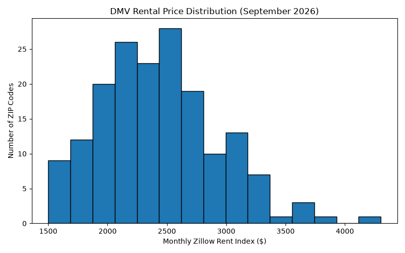
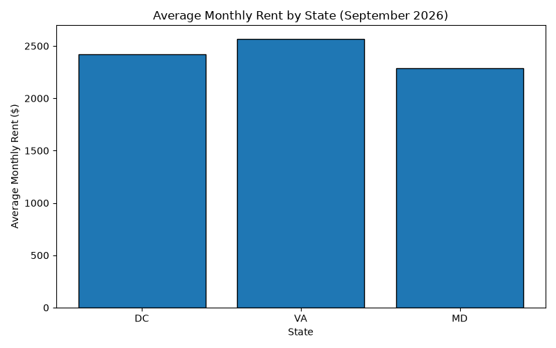

# DMV Rental Market Analysis

### CSCI 6201 - Software Fundamentals | Fall 2026

A Python project analyzing rental prices in the Washington, D.C. metropolitan area (DMV).

## Team Members

| Student name | GitHub username | Contribution |
| --- | --- | --- |
| Lintao Mei | @Randolph-mei | Set up the repository and Python environment, ran the data exploration, created the plots, trained and evaluated the decision tree, and prepared the documentation with AI guidance. |
| Admuthe, Harshvardhan | | Helped choose the project direction, took part in discussions, analyzed the plots, checked the code, and tested the model. |

## About This Project

Finding affordable housing can be challenging for international students and people who are new to the DMV area.

This project aims to help students and workers better understand rental prices across Washington, D.C., Northern Virginia, and Maryland.

Using real-world data from Zillow and the U.S. Census Bureau, the project analyzes rental prices by ZIP Code and visualizes the results through charts and an interactive map.

## Data Sources

**1. Zillow Rental Data**

- Source: [Zillow Research](https://www.zillow.com/research/data/)
- Dataset: Zillow Observed Rent Index (ZORI)
- File: `Zip_zori_uc_sfrcondomfr_sm_month.csv`
- Used to analyze monthly rental prices by ZIP Code.

**2. U.S. Census Bureau Data**

- Source: [Census Gazetteer Files](https://www.census.gov/geographies/reference-files/time-series/geo/gazetteer-files.html)
- File: `2026_Gaz_zcta_national.txt`
- Used to obtain geographic coordinates for ZIP Code areas.

The current analysis uses rental data from September 2026.

## Technologies Used

- Python
- Pandas
- Matplotlib
- Folium

## Project Features

**Figure 1: Rental Price Distribution**
figures/01_rental_distribution.png



**Figure 2: Average Monthly Rent by State**



**Figure 3: Interactive Rental Map**

[View Interactive Rental Map](figures/03_rental_map.html)
- Scroll down if you cannot open it (Keep reading!!!)

Markers are divided into three groups:

- Green: Below $2,000
- Orange: $2,000–$2,999
- Red: $3,000 or higher

Clicking a marker displays its ZIP Code, state, and estimated monthly rent.

## How to Run
(Before running the map, you should run 01,02,03 file first)

**Install the required libraries**
(if you don't have pip/pandas, please install it)

```bash
pip install pandas matplotlib folium
```

**make sure you are in the right folder(like csci6201-new-final-project/result)**
```bash
cd csci6201-new-final-project/result
```

**Open the interactive rental map**

Start a local HTTP server from the project root directory:

```bash
python -m http.server 8000
```

Open the following URL in your browser:

http://localhost:8000/figures/03_rental_map.html

The map allows users to zoom in, explore different areas, and click markers to view rental information.

**To stop the server:** Return to the terminal and press `Ctrl + C`.

**Note:** Need Internet to Show the Figure 3 Background Map

## Project Results

The program currently generates three visualization files:

| File | Description |
|---|---|
| `01_rental_distribution.png` | Distribution of monthly rental prices |
| `02_average_rent_by_state.png` | Average rent comparison |
| `03_rental_map.html` | Interactive DMV rental map |

All files are saved in the `figures` folder.

## Limitations

The rental prices are based on Zillow's rental index rather than individual apartment listings.

Map markers represent geographic areas associated with ZIP codes, not individual rental properties.
